## 基于springboot的学生成绩管理系统(程序+报告)

###  获取完整源码和sql数据库文件（完全免费）:  微信: littlepinia88 qq：1104515926
###  所有项目以及源代码本人均调试运行无问题 可支持远程安装部署调试、定制修改、代码讲解

## 项目介绍

本项目是一个基于 Spring Boot 的学生成绩管理系统，面向学校班级、专业、课程与综合成绩的日常教学管理场景，采用「用户端静态页面 + Vue 管理端」双端结构：学生与教师在用户端浏览课程、查询成绩、留言，管理员在后台维护班级、专业、师生档案、课程与成绩。后端为单一 Spring Boot 服务，通过 MyBatis-Plus 操作 MySQL，管理端 Vue 产物与用户端 HTML 页面均由服务端静态托管，可作为课程设计、毕业设计或教学管理类项目的入门实践案例。

### 系统角色
- **管理员**：后台账号存放于 `users` 表（含 `role` 字段），登录后台维护学生、教师、班级、专业、课程、综合成绩、留言与公告。
- **学生**：独立账号存放于 `xuesheng` 表，按学号登录，浏览课程信息、查询本人综合成绩、留言提问、收藏与查看公告。
- **教师**：独立账号存放于 `jiaoshi` 表，按工号登录，维护任教课程信息、登记学生综合成绩、回复留言。
- **权限控制**：后端由 `AuthorizationInterceptor` 统一拦截 `/**`，依据请求头 `Token` 校验登录态，登录、注册、重置密码等接口以 `@IgnoreAuth` 放行，未登录请求返回 401。

### 用户端功能
1. **注册与登录**：学生按学号注册（姓名、性别、手机、邮箱、所属班级与专业），教师按工号注册；登录后返回 Token，支持退出与密码重置。
2. **课程信息浏览**：按班级、专业、学期筛选课程，展示课程名称、封面、课时、上课时间与地点、任教教师及课程详情。
3. **成绩查询**：学生按学年查看本人学业、德育、体育素质、智育素质与总分（`zongfen`）。
4. **教师信息查看**：展示教师姓名、性别、手机、邮箱、职务等公开资料。
5. **留言板**：学生与教师发表留言（`messages`），可附图，后台回复后展示回复内容与回复附图。
6. **收藏与公告**：收藏课程等内容（`storeup`），浏览公告资讯（`news`）。

### 管理端功能
1. **管理员账号**：对 `users` 后台账号分页维护与重置密码。
2. **学生管理**：学生（`xuesheng`）档案增删改查，含学号、性别、手机、邮箱、班级、专业。
3. **教师管理**：教师（`jiaoshi`）工号、姓名、性别、手机、邮箱、职务维护。
4. **班级与专业管理**：维护班级（`banji`）与专业（`zhuanye`）基础数据。
5. **课程信息管理**：课程名称、封面、课时、所属班级/专业、上课时间地点、学期与任教教师的增删改查。
6. **综合成绩管理**：按学生登记学业、德育、体育素质、智育素质与总分，记录登记时间与登记教师。
7. **留言与公告管理**：回复用户留言（`messages`），发布与维护公告资讯（`news`）。

### 技术栈
- **后端框架**：Spring Boot 2.2.2.RELEASE、Spring MVC、Spring AOP，JDK 1.8
- **数据访问**：MyBatis-Plus 2.3 + mybatis-spring-boot-starter 2.1.1，MySQL，mapper XML 位于 `classpath*:mapper/*.xml`
- **前端与模板**：管理端 Vue 2 + Element UI（`admin/admin/src`，产物 `dist` 静态托管）；用户端 Layui + Element UI + jQuery/Ajax 静态页面（`front/front/pages`），富文本使用 TinyMCE
- **工程能力**：统一 `R` 响应模型、`AuthorizationInterceptor` Token 鉴权与 `@IgnoreAuth` 放行、跨域 Origin 反射放行、图片上传至 `static/upload`、Fastjson 1.2.8、Hutool 4.0.12、POI 导出
- **构建运行**：Maven + `spring-boot-maven-plugin` 打包为可执行 jar

### 核心数据表
- `xuesheng` 学生表：学号 `xuehao`、密码 `mima`、姓名 `xueshengxingming`、性别 `xingbie`、手机 `shoujihaoma`、邮箱 `youxiang`、班级 `banji`、专业 `zhuanye`、头像 `touxiang`
- `jiaoshi` 教师表：教师工号 `jiaoshigonghao`、姓名 `jiaoshixingming`、职务 `zhiwu`、手机 `shoujihaoma`、邮箱 `youxiang`、头像 `touxiang`
- `banji` 班级表：班级名称 `banji`
- `zhuanye` 专业表：专业名称 `zhuanye`
- `kechengxinxi` 课程信息表：课程名称 `kechengmingcheng`、封面 `fengmian`、课时 `keshi`、班级 `banji`、专业 `zhuanye`、上课时间 `shangkeshijian`、上课地点 `shangkedidian`、学期 `xueqi`、教师工号 `jiaoshigonghao`
- `zonghechengji` 综合成绩表：学号 `xuehao`、学业成绩 `xueyechengji`、德育成绩 `deyuchengji`、体育素质 `tiyusuzhi`、智育素质 `zhiyusuzhi`、总分 `zongfen`、学年 `xuenian`、登记时间 `dengjishijian`
- `messages` 留言表：用户 `userid`、留言内容 `content`、留言附图 `cpicture`、回复 `reply`、回复附图 `rpicture`
- `news` 公告表：标题 `title`、简介 `introduction`、图片 `picture`、内容 `content`
- `storeup` 收藏表：所属用户 `userid`、关联表 `tablename`、关联 ID `refid`

### 工程结构
```
A018springbooto8mkp
├── src/main/java/com
│   ├── controller/      REST 控制器（学生、教师、班级、专业、课程、成绩、留言等）
│   ├── entity/           实体类与 model/vo 视图对象
│   ├── dao/              MyBatis-Plus Mapper 接口
│   ├── service/          业务接口与 impl 实现
│   ├── interceptor/      AuthorizationInterceptor Token 鉴权拦截器
│   ├── config/           拦截器注册、MyBatis-Plus 配置
│   ├── annotation/       @IgnoreAuth 免登录注解
│   └── utils/            R、分页、文件上传、MD5、SQL 过滤等工具
├── src/main/resources
│   ├── mapper/          MyBatis mapper XML
│   ├── admin/admin/src  管理端 Vue2 + Element UI 源码
│   ├── admin/admin/dist 管理端打包产物（静态托管）
│   ├── front/front/pages 用户端 HTML 页面（home、kechengxinxi、zonghechengji、messages 等）
│   ├── static/upload/   上传文件目录
│   └── application.yml  端口、数据源、MyBatis-Plus 配置
├── screenshot/          运行截图
└── pom.xml
```

### 访问入口
- 用户端：`http://localhost:8080/springbooto8mkp/front/front/index.html`
- 管理端：`http://localhost:8080/springbooto8mkp/admin/admin/dist/index.html`
- 后端 API 基址：`http://localhost:8080/springbooto8mkp`（登录接口为 `POST /users/login`、`/xuesheng/login`、`/jiaoshi/login`）

### 补充说明
- 端口 8080、上下文路径 `/springbooto8mkp`、数据库 `a018_springbooto8mkp` 均在 `src/main/resources/application.yml` 中配置，首次运行需先导入 SQL 并按本机 MySQL 调整账号密码（默认 root/123456）。
- 学生与教师密码以明文比对、登录态基于数据库 Token 表，鉴权由 `AuthorizationInterceptor` 完成，未使用 Shiro/Spring Security 权限框架。
- 上传图片保存在本地 `static/upload` 目录并通过静态资源映射访问；跨域由拦截器按请求 Origin 反射放行。

## 运行环境
- JDK版本：JDK1.8及以上
- 开发工具：IDEA、Ecplise、Myecplise都可以
- 数据库: MySQL5.7及以上
- Node：14.14.0及以上

## 运行截图
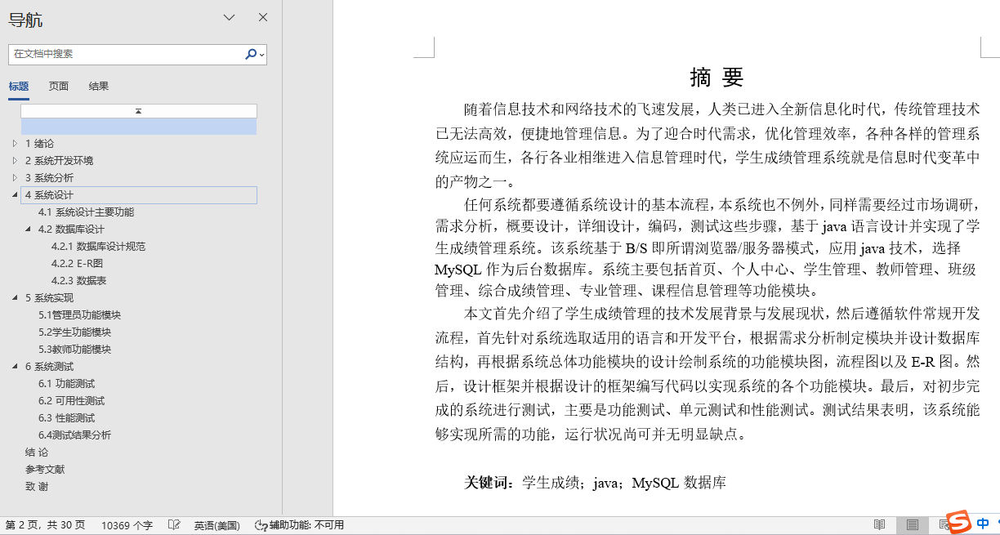

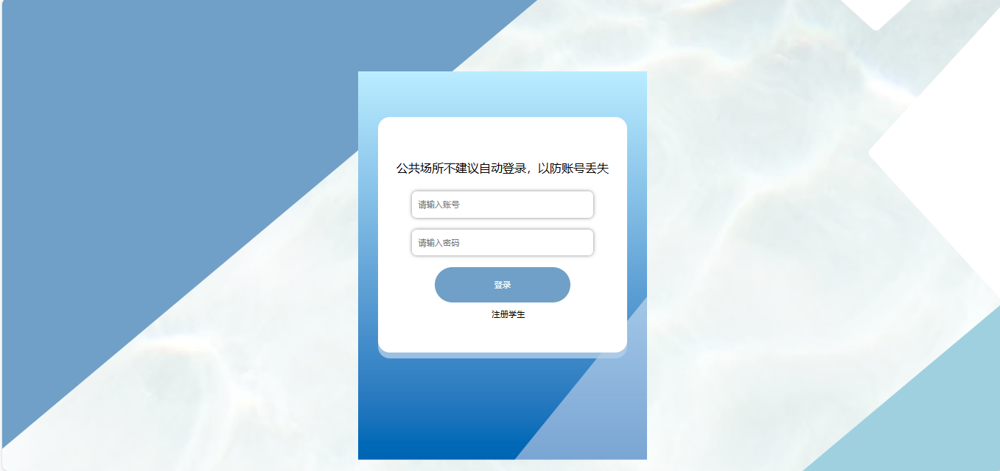

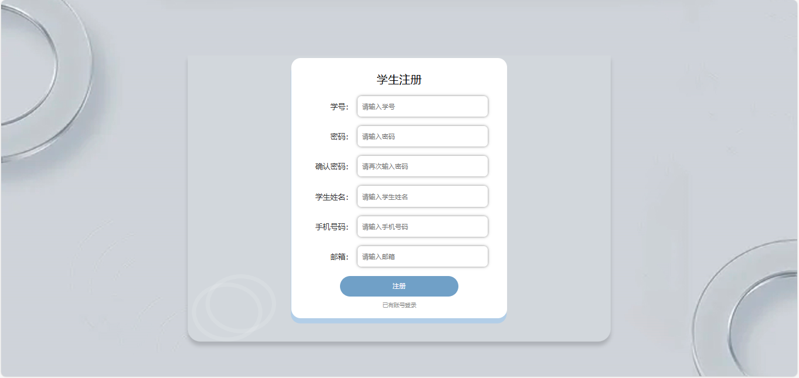

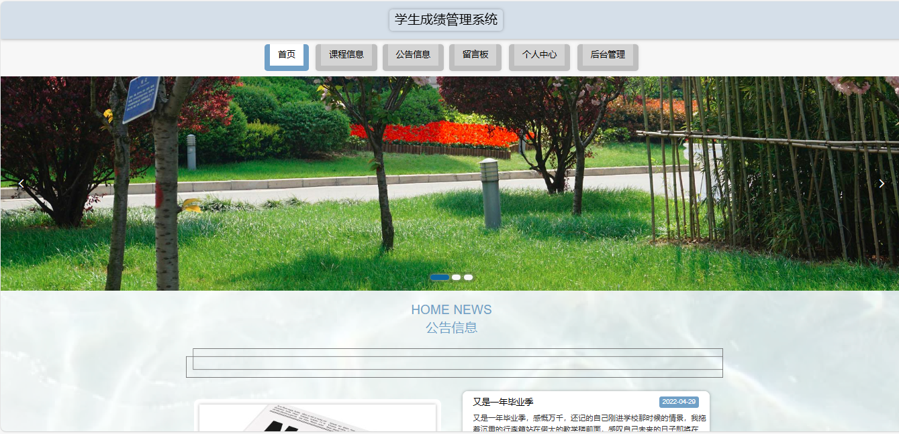

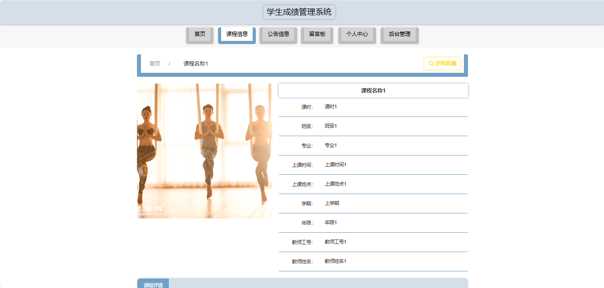

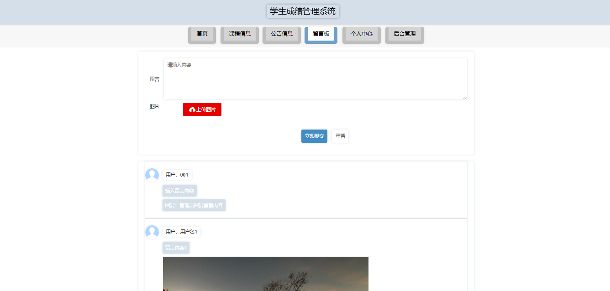

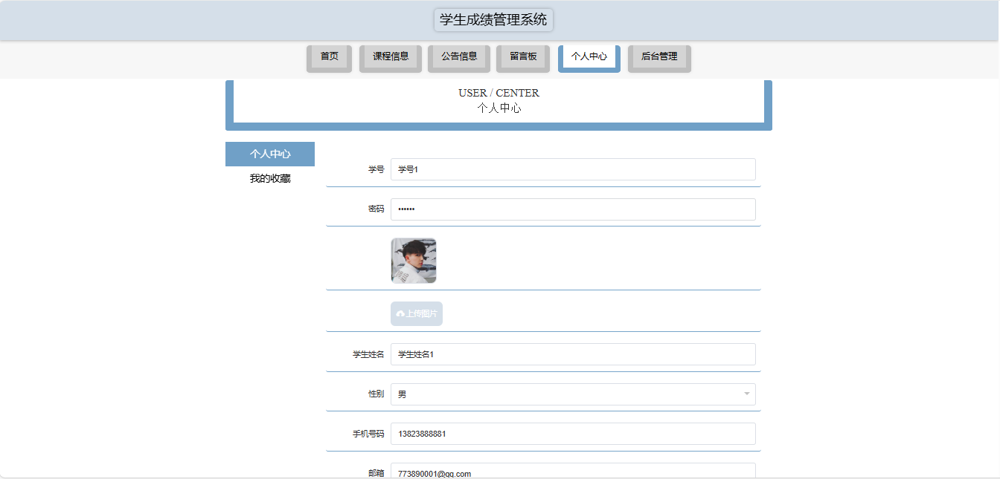

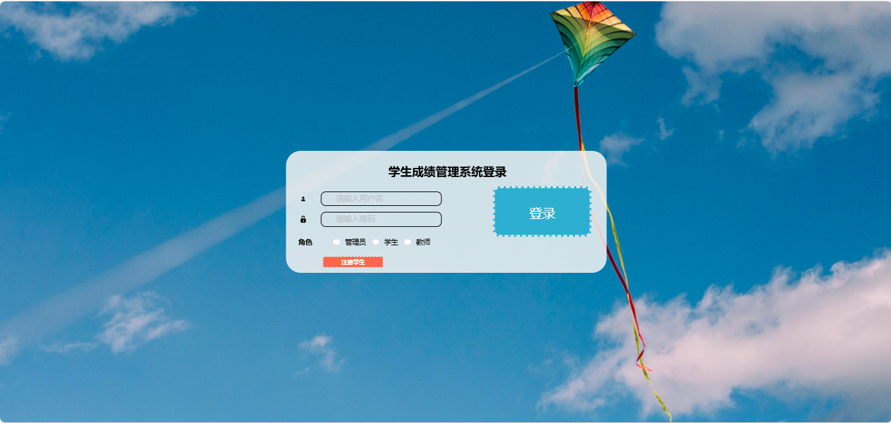

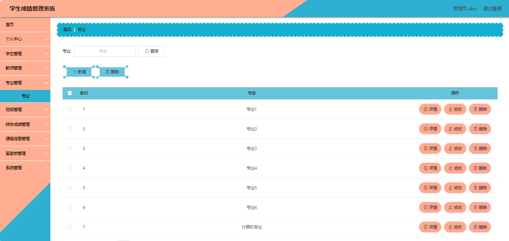

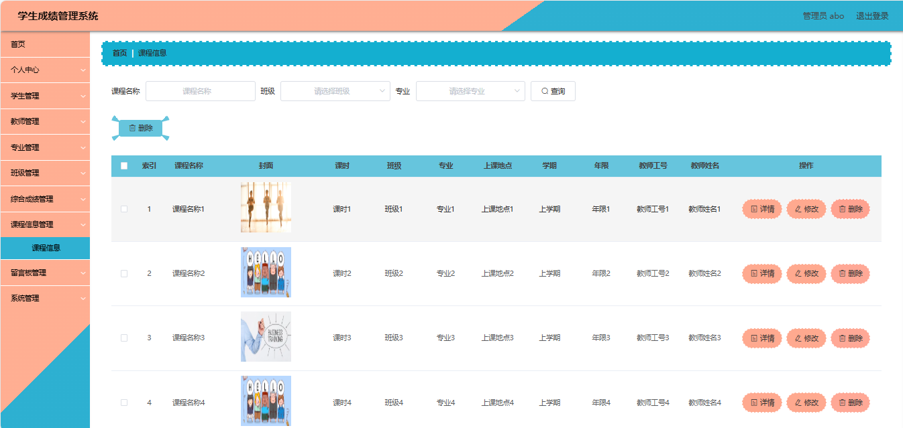

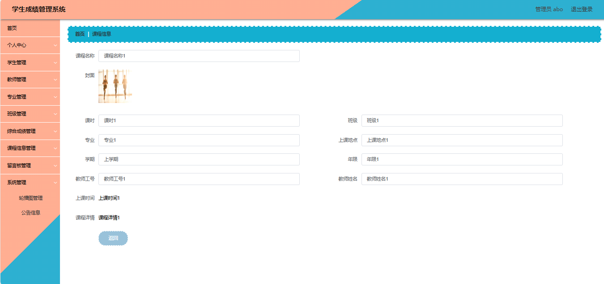